<div align="center">

# CaiWen（财问）

[](https://www.python.org/downloads/)
[](https://nextjs.org/)
[](LICENSE)
[](https://github.com/112-Li-del/CaiWen/releases)

[核心功能](#-核心功能) · [快速开始](#-快速开始) · [功能探索](#-功能探索) · [TutorBot](#-tutorbot) · [CLI](#-cli) · [多用户](#-多用户)

</div>

## ✨ 核心功能

- **统一聊天工作区** — 六种模式，一个对话线程。聊天、深度求解、题目生成、深度研究、数学动画和可视化共享同一上下文——可以随时开始对话、升级到多 Agent 问题求解、生成测验、可视化概念，然后深入研究，全程不丢失任何信息。
- **AI Co-Writer** — 多文档 Markdown 工作区，AI 是一等协作者。选中文字即可重写、扩展或总结——从你的知识库和网络中汲取内容。每一个片段都能反哺到你的学习生态系统中。
- **Book Engine** — 将你的学习材料转化为结构化、交互式的"活书"。多 Agent 管道设计大纲、检索相关来源、编译包含 13 种块类型的丰富页面——测验、闪卡、时间线、概念图、交互演示等。
- **知识中心** — 上传 PDF、Markdown 和文本文件构建 RAG 就绪的知识库。在彩色标签的笔记本中整理知识点，在题库中回顾测验题目，创建自定义 Skills 来塑造 CaiWen 如何教你。你的文档不只是堆在那里——它们会为每一次对话提供动力。
- **持久化记忆** — CaiWen 构建你的动态学习画像：你学过什么、怎么学的、目标是什么。记忆在所有功能和所有 TutorBot 之间共享，每次互动都让它更加精准。
- **个人 TutorBot** — 不是聊天机器人，是自主导师。每个 TutorBot 拥有自己的工作区、记忆、个性和技能集。它们设置提醒、学习新能力，与你共同成长。基于 [nanobot](https://github.com/HKUDS/nanobot) 构建。
- **Agent 原生 CLI** — 所有能力、知识库、会话和 TutorBot 都只需一条命令。人类获得丰富的终端输出，AI Agent 获得结构化 JSON。把 [`SKILL.md`](SKILL.md) 交给 CaiWen，你的 Agent 就能自主操作它。
- **可选认证** — 本地使用默认关闭。设置两个环境变量即可在公开部署时要求登录。多用户支持，bcrypt 哈希密码、JWT 会话、自助注册页面和内置管理后台管理账户和角色。可选 **PocketBase** 支持 OAuth 认证和改进的多用户并发——作为可选边车部署，无需修改代码。

---

## 🚀 快速开始

### 环境要求

开始之前，请确保你的系统已安装以下依赖：

| 依赖 | 版本 | 检查命令 | 说明 |
|:---|:---|:---|:---|
| [Git](https://git-scm.com/) | 任意 | `git --version` | 用于克隆仓库 |
| [Python](https://www.python.org/downloads/) | 3.11+ | `python --version` | 后端运行时 |
| [Node.js](https://nodejs.org/) | 20.9+ | `node --version` | 前端运行时（本地 Web 安装需要） |
| [npm](https://www.npmjs.com/) | 随 Node.js 附带 | `npm --version` | 随 Node.js 一起安装 |

> **仅 Windows（缺少编译器修复）：** 如果你没有 Visual Studio，请安装 [Visual Studio Build Tools](https://visualstudio.microsoft.com/visual-cpp-build-tools/) 并确保选中 **Desktop development with C++** 工作负载。

你还需要一个来自至少一个 LLM 提供商的 **API 密钥**（例如 [OpenAI](https://platform.openai.com/api-keys)、[DeepSeek](https://platform.deepseek.com/)、[Anthropic](https://console.anthropic.com/)）。Setup Tour 会引导你完成配置。

### 方式 A — Setup Tour（推荐）

一个引导式 CLI 向导，适用于首次本地 Web 设置。它会检查你的环境、安装 Python 和 Node.js 依赖、写入 `.env`，并让你选择可选的附加组件，如 TutorBot、Matrix 和 Math Animator。

**1. 克隆仓库**

```bash
git clone https://github.com/112-Li-del/CaiWen.git
cd CaiWen
```

**2. 创建并激活 Python 环境**

根据你的系统，选择**其中一种**方式。

macOS / Linux 使用 `venv`：

```bash
python3 -m venv .venv
source .venv/bin/activate
python -m pip install --upgrade pip
```

Windows PowerShell 使用 `venv`：

```powershell
py -3.11 -m venv .venv
.\.venv\Scripts\Activate.ps1
python -m pip install --upgrade pip
```

Anaconda / Miniconda：

```bash
conda create -n deeptutor python=3.11
conda activate deeptutor
python -m pip install --upgrade pip
```

**3. 启动引导式向导**

```bash
python scripts/start_tour.py
```

安装过程中，向导会询问你要安装哪个依赖配置：

| 选择 | 安装内容 | 适用场景 |
|:---|:---|:---|
| Web app（推荐） | CLI + API 服务器 + RAG/文档解析 | 大多数首次使用的用户 |
| Web + TutorBot | 增加 TutorBot 引擎和常用渠道 SDK | 需要自主辅导机器人或渠道集成 |
| Web + TutorBot + Matrix | 增加 Matrix / Element 渠道支持（不含 E2EE） | 需要 Matrix/Element 房间；仅加密房间需安装 `matrix-e2e` |
| Math Animator 插件 | 单独安装 Manim | 仅当你需要动画生成，且已备好 LaTeX/ffmpeg/系统构建工具 |

向导完成后：

```bash
python scripts/start_web.py
```

> **日常启动** — 引导只需一次。之后保持该 Python 环境激活，运行 `python scripts/start_web.py` 即可同时启动后端和前端。前端 URL 会打印在终端中。只有当你需要重新配置提供商、更改端口或安装可选附加组件时，才需要重新运行 `start_tour.py`。

> **更新本地安装** — 如果你通过方式 A 或 B 从 git clone 安装，运行 `python scripts/update.py`。更新器会 fetch 当前分支的远程仓库，显示本地与远程的提交差距，确认检测到的分支映射，然后执行安全的快进拉取。

### 方式 B — 手动本地安装

如果你偏好手动执行每条设置命令，请选择此方式。

**1. 克隆仓库**

```bash
git clone https://github.com/112-Li-del/CaiWen.git
cd CaiWen
```

**2. 创建并激活 Python 环境**

选择**其中一种**方式。

macOS / Linux 使用 `venv`：

```bash
python3 -m venv .venv
source .venv/bin/activate
python -m pip install --upgrade pip
```

Windows PowerShell 使用 `venv`：

```powershell
py -3.11 -m venv .venv
.\.venv\Scripts\Activate.ps1
python -m pip install --upgrade pip
```

Anaconda / Miniconda：

```bash
conda create -n deeptutor python=3.11
conda activate deeptutor
python -m pip install --upgrade pip
```

**3. 安装依赖**

```bash
# 后端 + Web 服务器依赖。包含 CLI、RAG、文档解析和内置 LLM 提供商 SDK。
python -m pip install -e ".[server]"

# 可选附加组件 — 按需安装：
#   python -m pip install -e ".[tutorbot]"        # TutorBot 引擎 + 渠道 SDK
#   python -m pip install -e ".[tutorbot,matrix]"  # TutorBot + Matrix 渠道（不含 E2EE/libolm）
#   python -m pip install -e ".[matrix-e2e]"        # 可选加密 Matrix 房间；需要 libolm
#   python -m pip install -e ".[math-animator]"     # Manim；另需 LaTeX/ffmpeg/系统构建工具
#   python -m pip install -e ".[all]"               # 以上全部 + 开发工具

# 前端依赖。需要 Node.js 20.9+。
cd web
npm install
cd ..
```

**4. 配置环境变量**

```bash
cp .env.example .env
```

编辑 `.env`，至少填写 LLM 相关字段。Embedding 字段是知识库功能所需的，如果只想先试用聊天功能，可以稍后再填。

```dotenv
# LLM（聊天必填）
LLM_BINDING=openai
LLM_MODEL=gpt-4o-mini
LLM_API_KEY=sk-xxx
LLM_HOST=https://api.openai.com/v1

# Embedding（知识库 / RAG 必填）
EMBEDDING_BINDING=openai
EMBEDDING_MODEL=text-embedding-3-large
EMBEDDING_API_KEY=sk-xxx
# v1.3.0+：请使用完整端点 URL，而不仅仅是 https://api.openai.com/v1
EMBEDDING_HOST=https://api.openai.com/v1/embeddings
# 留空即可，除非需要强制指定维度。
EMBEDDING_DIMENSION=
```

<details>
<summary><b>支持的 LLM 提供商</b></summary>

| 提供商 | Binding | 默认 Base URL |
|:--|:--|:--|
| AiHubMix | `aihubmix` | `https://aihubmix.com/v1` |
| Anthropic | `anthropic` | `https://api.anthropic.com/v1` |
| Azure OpenAI | `azure_openai` | — |
| BytePlus | `byteplus` | `https://ark.ap-southeast.bytepluses.com/api/v3` |
| BytePlus Coding Plan | `byteplus_coding_plan` | `https://ark.ap-southeast.bytepluses.com/api/coding/v3` |
| Custom | `custom` | — |
| Custom（Anthropic API） | `custom_anthropic` | — |
| DashScope | `dashscope` | `https://dashscope.aliyuncs.com/compatible-mode/v1` |
| DeepSeek | `deepseek` | `https://api.deepseek.com` |
| Gemini | `gemini` | `https://generativelanguage.googleapis.com/v1beta/openai/` |
| GitHub Copilot | `github_copilot` | `https://api.githubcopilot.com` |
| Groq | `groq` | `https://api.groq.com/openai/v1` |
| llama.cpp | `llama_cpp` | `http://localhost:8080/v1` |
| LM Studio | `lm_studio` | `http://localhost:1234/v1` |
| MiniMax | `minimax` | `https://api.minimaxi.com/v1` |
| MiniMax（Anthropic） | `minimax_anthropic` | `https://api.minimaxi.com/anthropic` |
| Mistral | `mistral` | `https://api.mistral.ai/v1` |
| Moonshot | `moonshot` | `https://api.moonshot.cn/v1` |
| NVIDIA NIM | `nvidia_nim` | `https://integrate.api.nvidia.com/v1` |
| Ollama | `ollama` | `http://localhost:11434/v1` |
| OpenAI | `openai` | `https://api.openai.com/v1` |
| OpenAI Codex | `openai_codex` | `https://chatgpt.com/backend-api` |
| OpenRouter | `openrouter` | `https://openrouter.ai/api/v1` |
| OpenVINO Model Server | `ovms` | `http://localhost:8000/v3` |
| Qianfan | `qianfan` | `https://qianfan.baidubce.com/v2` |
| SiliconFlow | `siliconflow` | `https://api.siliconflow.cn/v1` |
| Step Fun | `stepfun` | `https://api.stepfun.com/v1` |
| vLLM/Local | `vllm` | — |
| VolcEngine | `volcengine` | `https://ark.cn-beijing.volces.com/api/v3` |
| VolcEngine Coding Plan | `volcengine_coding_plan` | `https://ark.cn-beijing.volces.com/api/coding/v3` |
| Xiaomi MIMO | `xiaomi_mimo` | `https://api.xiaomimimo.com/v1` |
| Zhipu AI | `zhipu` | `https://open.bigmodel.cn/api/paas/v4` |

</details>

<details>
<summary><b>支持的 Embedding 提供商</b></summary>

| 提供商 | Binding | 模型示例 | 默认维度 |
|:--|:--|:--|:--|
| OpenAI | `openai` | `text-embedding-3-large` | 3072 |
| Azure OpenAI | `azure_openai` | 部署名称 | — |
| Cohere | `cohere` | `embed-v4.0` | 1024 |
| Jina | `jina` | `jina-embeddings-v3` | 1024 |
| Ollama | `ollama` | `nomic-embed-text` | 768 |
| vLLM / LM Studio | `vllm` | 任意嵌入模型 | — |
| 任意 OpenAI 兼容 | `custom` | — | — |

OpenAI 兼容的提供商（DashScope、SiliconFlow 等）可通过 `custom` 或 `openai` binding 正常工作。

</details>

<details>
<summary><b>支持的网络搜索提供商</b></summary>

| 提供商 | 环境变量 | 备注 |
|:--|:--|:--|
| Brave | `BRAVE_API_KEY` | 推荐，有免费额度 |
| Tavily | `TAVILY_API_KEY` | |
| Serper | `SERPER_API_KEY` | 通过 Serper 获取 Google 搜索结果 |
| Jina | `JINA_API_KEY` | |
| SearXNG | — | 自托管，无需 API 密钥 |
| DuckDuckGo | — | 无需 API 密钥 |
| Perplexity | `PERPLEXITY_API_KEY` | 需要 API 密钥 |

</details>

**5. 启动服务**

最快的一键启动方式：

```bash
python scripts/start_web.py
```

这会同时启动后端和前端。保持终端打开，然后在浏览器中打开终端打印的前端 URL。

或者，分别在两个终端中手动启动：

```bash
# 后端（FastAPI）
python -m deeptutor.api.run_server

# 前端（Next.js）——在另一个终端中
cd web && npm run dev -- -p 3782
```

| 服务 | 默认端口 |
|:---:|:---:|
| 后端 | `8001` |
| 前端 | `3782` |

打开 [http://localhost:3782](http://localhost:3782)，就可以开始使用了。

### 方式 C — Docker 部署

Docker 将后端和前端打包到一个容器中——不需要本地安装 Python 或 Node.js。你只需要 [Docker Desktop](https://www.docker.com/products/docker-desktop/)（或 Linux 上的 Docker Engine + Compose）。

**1. 配置环境变量**（以下两种方式都需要）

```bash
git clone https://github.com/112-Li-del/CaiWen.git
cd CaiWen
cp .env.example .env
```

编辑 `.env`，至少填写必填字段（同上[方式 B](#方式-b--手动本地安装)）。

**2a. 拉取官方镜像（推荐）**

官方镜像每次发布时都会推送到 [GitHub Container Registry](https://github.com/112-Li-del/CaiWen/pkgs/container/caiwen)，支持 `linux/amd64` 和 `linux/arm64` 架构。

```bash
docker compose -f docker-compose.ghcr.yml up -d
```

如需固定特定版本，编辑 `docker-compose.ghcr.yml` 中的镜像标签：

```yaml
image: ghcr.io/112-li-del/caiwen:1.3.4  # 或 :latest
```

**2b. 从源码构建**

```bash
docker compose up -d
```

这会从 `Dockerfile` 本地构建镜像并启动容器。

**3. 验证和管理**

容器健康运行后，打开 [http://localhost:3782](http://localhost:3782)。

```bash
docker compose logs -f   # 跟踪日志
docker compose down       # 停止并移除容器
```

<details>
<summary><b>云端 / 远程服务器部署</b></summary>

部署到远程服务器时，浏览器需要知道后端 API 的公网 URL。在 `.env` 中添加一个变量：

```dotenv
# 设置为后端可访问的公网 URL
NEXT_PUBLIC_API_BASE_EXTERNAL=https://your-server.com:8001
```

前端启动脚本会在运行时应用该值——无需重新构建。

</details>

<details>
<summary><b>认证（公开部署）</b></summary>

认证**默认关闭**——本地使用时无需登录。对于多租户部署（用户隔离工作区、管理员管理模型/知识库/技能、审计日志），请参见下方专门的[多用户](#-多用户--共享部署与用户隔离工作区)部分了解完整设置、环境变量参考和操作注意事项。

**无头单用户模式（无需 `/register` 流程）：** 如果你无法通过浏览器引导第一个管理员（例如无人值守容器），可以通过环境变量预置凭据：

```bash
# 在任意已 clone 该项目的机器上生成 bcrypt 哈希：
python -c "from deeptutor.services.auth import hash_password; print(hash_password('yourpassword'))"
```

```dotenv
AUTH_ENABLED=true
AUTH_USERNAME=admin
AUTH_PASSWORD_HASH=<在此粘贴哈希>
# 可选。留空时自动在 multi-user/_system/auth/auth_secret 下生成。
AUTH_SECRET=your-secret-here
```

此环境变量路径服务单个账户，被视为管理员。一旦你通过浏览器注册流程，磁盘存储 `multi-user/_system/auth/users.json` 将具有更高优先级，环境变量成为后备方案。

</details>

<details>
<summary><b>PocketBase 边车（可选认证 + 存储）</b></summary>

PocketBase 是一个可选的轻量级后端，替代内置的 SQLite/JSON 认证和会话存储。它提供 OAuth 认证、实时订阅和可视化管理面板——如果不设置 `POCKETBASE_URL`，零改动即可切回原有方式。

> ⚠️ **PocketBase 模式目前仅支持单用户。** 默认 schema 在 `users` 上没有 `role` 字段（每次登录解析为 `role=user`，无法创建管理员），且会话/消息/轮次查询未按 `user_id` 过滤。多用户部署请保持 `POCKETBASE_URL` 为空，使用默认的 JSON/SQLite 后端。

**适用场景：** 需要 OAuth 认证和可视化管理面板的本地单用户设置，暂不考虑用户隔离。

**快速开始（Docker Compose）：**

```bash
# 使用 docker compose 时，PocketBase 会自动随 CaiWen 一起启动
docker compose up -d

# 1. 打开管理面板并创建管理员账户
open http://localhost:8090/_/

# 2. 引导 collections（仅需运行一次）
pip install pocketbase
python scripts/pb_setup.py

# 3. 在 .env 中启用 PocketBase 并重启
```

**需要添加到 `.env` 的配置：**

```dotenv
POCKETBASE_URL=http://localhost:8090          # Docker 内使用 http://pocketbase:8090
POCKETBASE_ADMIN_EMAIL=admin@example.com
POCKETBASE_ADMIN_PASSWORD=your-admin-password
```

**devenv 用户：**

```bash
devenv up   # 启动 PocketBase（:8090）、后端和前端
```

随时可以通过移除 `POCKETBASE_URL`（或留空）回退到内置 SQLite 后端——新会话无需数据迁移。

</details>

<details>
<summary><b>开发模式（热重载）</b></summary>

叠加开发覆盖文件以挂载源代码并为两个服务启用热重载：

```bash
docker compose -f docker-compose.yml -f docker-compose.dev.yml up
```

对 `deeptutor/`、`deeptutor_cli/`、`scripts/` 和 `web/` 的更改会立即生效。

</details>

<details>
<summary><b>自定义端口</b></summary>

在 `.env` 中覆盖默认端口：

```dotenv
BACKEND_PORT=9001
FRONTEND_PORT=4000
```

然后重启：

```bash
docker compose up -d     # 或 docker compose -f docker-compose.ghcr.yml up -d
```

</details>

<details>
<summary><b>数据持久化</b></summary>

用户数据和知识库通过映射到本地目录的 Docker 卷持久化：

| 容器路径 | 宿主机路径 | 内容 |
|:---|:---|:---|
| `/app/data/user` | `./data/user` | 设置、工作区、会话、日志 |
| `/app/data/memory` | `./data/memory` | 共享长期记忆（`SUMMARY.md`、`PROFILE.md`） |
| `/app/data/knowledge_bases` | `./data/knowledge_bases` | 上传的文档和向量索引 |

这些目录在 `docker compose down` 之后仍然存在，下次 `docker compose up` 时会继续使用。

</details>

<details>
<summary><b>环境变量参考</b></summary>

> 查看 [`.env.example`](.env.example) 获取完整的注释说明列表。下表涵盖了大多数用户需要配置的变量。

| 变量 | 是否必填 | 说明 |
|:---|:---:|:---|
| `LLM_BINDING` | **是** | LLM 提供商（`openai`、`anthropic`、`deepseek` 等） |
| `LLM_MODEL` | **是** | 模型名称（如 `gpt-4o`） |
| `LLM_API_KEY` | **是** | 你的 LLM API 密钥 |
| `LLM_HOST` | **是** | Chat-completions 的 Base URL |
| `LLM_API_VERSION` | 否 | Azure OpenAI 需要填写；其他留空 |
| `LLM_REASONING_EFFORT` | 否 | DeepSeek `high`/`max`/`minimal` 或 OpenAI o 系列 `low`/`medium`/`high` |
| `EMBEDDING_BINDING` | 仅知识库 | Embedding 提供商 |
| `EMBEDDING_MODEL` | 仅知识库 | Embedding 模型名称 |
| `EMBEDDING_API_KEY` | 仅知识库 | Embedding API 密钥 |
| `EMBEDDING_HOST` | 仅知识库 | Embedding 端点完整 URL（v1.3.0+——直接调用，不额外拼接路径） |
| `EMBEDDING_DIMENSION` | 否 | 向量维度；留空自动检测 |
| `EMBEDDING_SEND_DIMENSIONS` | 否 | 三态——`true`/`false`/留空（自动） |
| `SEARCH_PROVIDER` | 否 | `brave`、`tavily`、`serper`、`jina`、`perplexity`、`searxng`、`duckduckgo` |
| `SEARCH_API_KEY` | 否 | 搜索 API 密钥 |
| `SEARCH_BASE_URL` | 否 | 自托管 SearXNG 需要填写 |
| `SEARCH_PROXY` | 否 | 可选 HTTP/HTTPS 代理用于外发搜索流量 |
| `BACKEND_PORT` | 否 | 后端端口（默认 `8001`） |
| `FRONTEND_PORT` | 否 | 前端端口（默认 `3782`） |
| `POCKETBASE_PORT` | 否 | 可选 PocketBase 边车的 Docker 端口映射（默认 `8090`） |
| `NEXT_PUBLIC_API_BASE_EXTERNAL` | 否 | 云端部署时的后端公网 URL |
| `NEXT_PUBLIC_API_BASE` | 否 | Next.js 客户端的后端 URL 直接覆盖 |
| `CORS_ORIGIN` | 否 | 追加到 FastAPI CORS 白名单的单个额外来源 |
| `CORS_ORIGINS` | 否 | 逗号/换行分隔的额外来源，用于认证远程部署 |
| `DISABLE_SSL_VERIFY` | 否 | 禁用外发 TLS 验证（默认 `false`） |
| `AUTH_ENABLED` | 否 | `true` 时需要登录（默认 `false`） |
| `NEXT_PUBLIC_AUTH_ENABLED` | 否 | 可选前端覆盖；留空时从 `AUTH_ENABLED` 派生 |
| `AUTH_SECRET` | 否 | JWT 签名密钥；留空时在 `multi-user/_system/auth/auth_secret` 下自动生成 |
| `AUTH_TOKEN_EXPIRE_HOURS` | 否 | 会话时长，小时为单位（默认 `24`） |
| `AUTH_COOKIE_SECURE` | 否 | 通过 HTTPS 提供服务时标记认证 Cookie 为 `Secure`（默认 `false`） |
| `AUTH_USERNAME` | 否 | 单用户模式：管理员用户名 |
| `AUTH_PASSWORD_HASH` | 否 | 单用户模式：管理员密码的 bcrypt 哈希 |
| `POCKETBASE_URL` | 否 | 设置以启用 PocketBase 边车（仅单用户——见上方警告） |
| `POCKETBASE_ADMIN_EMAIL` / `POCKETBASE_ADMIN_PASSWORD` | 否 | Python 后端管理 PocketBase collections 的管理员凭据 |
| `POCKETBASE_EXTERNAL_URL` | 否 | OAuth 重定向的 PocketBase 公网 URL（仅远程部署） |
| `CHAT_ATTACHMENT_DIR` | 否 | 覆盖聊天附件存储根目录 |

</details>

### 方式 D — 仅 CLI

如果你只需要 CLI 而不需要 Web 前端：

```bash
# 包含 RAG、文档解析和所有内置 LLM 提供商 SDK。
# 与方式 B 相同，但去除 FastAPI/uvicorn。
python -m pip install -e ".[cli]"
```

你仍然需要配置 LLM 提供商。最快捷的方式：

```bash
cp .env.example .env   # 然后编辑 .env 填入你的 API 密钥
```

配置完成后，就可以开始使用了：

```bash
deeptutor chat                                   # 交互式 REPL
deeptutor run chat "解释傅里叶变换"                # 一次性执行
deeptutor run deep_solve "解方程 x^2 = 4"          # 多 Agent 问题求解
deeptutor kb create my-kb --doc textbook.pdf      # 构建知识库
```

> 完整功能指南和命令参考请参见 [CaiWen CLI](#️-deeptutor-cli--agent-原生接口)。

---

## 📖 功能探索

<div align="center">
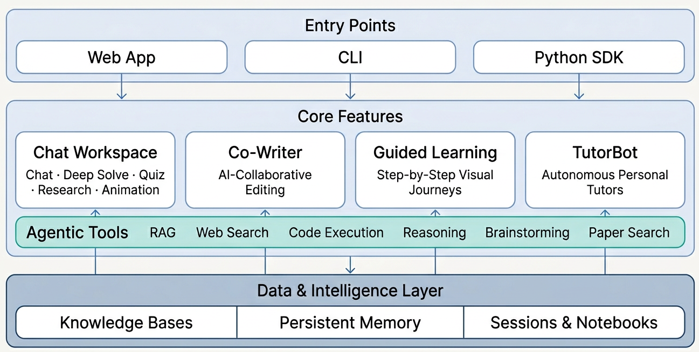
</div>

### 💬 Chat — 统一智能工作区

<div align="center">
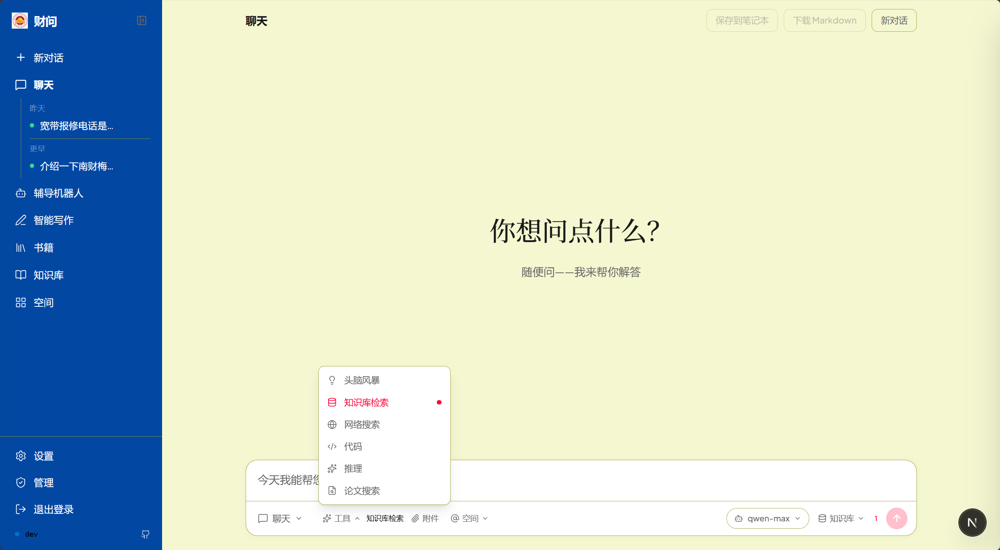
</div>

六种不同模式共存于一个工作区中，由**统一上下文管理系统**贯穿。对话历史、知识库和引用资料跨模式持久存在——在同一主题内自由切换模式，随时适应需要。

| 模式 | 功能说明 |
|:---|:---|
| **Chat** | 灵活、工具增强的对话。可选择 RAG 检索、网络搜索、代码执行、深度推理、头脑风暴和论文搜索——按需自由组合。 |
| **Deep Solve** | 多 Agent 问题求解：规划、调研、求解、验证——每一步都有精确的来源引用。 |
| **Quiz Generation** | 基于你的知识库生成测验，内建校验机制。 |
| **Deep Research** | 将主题分解为子主题，派遣并行研究 Agent 在 RAG、网络和学术论文间搜索，生成带完整引用的报告。 |
| **Math Animator** | 将数学概念转化为由 Manim 驱动的视觉动画和故事板。 |
| **Visualize** | 从自然语言描述生成交互式 SVG 图表、Chart.js 图表、Mermaid 图形或独立 HTML 页面。 |

工具与工作流**解耦**——在每个模式中，你决定启用哪些工具、用多少、甚至完全不用。工作流编排推理逻辑，工具由你自由组合。

> 从一个聊天问题开始，遇到困难就升级到 Deep Solve，可视化一个概念，生成测验自测，然后启动 Deep Research 深入探索——全部在一个连续的对话线程中完成。

### ✍️ Co-Writer — 多文档 AI 写作工作区

<div align="center">
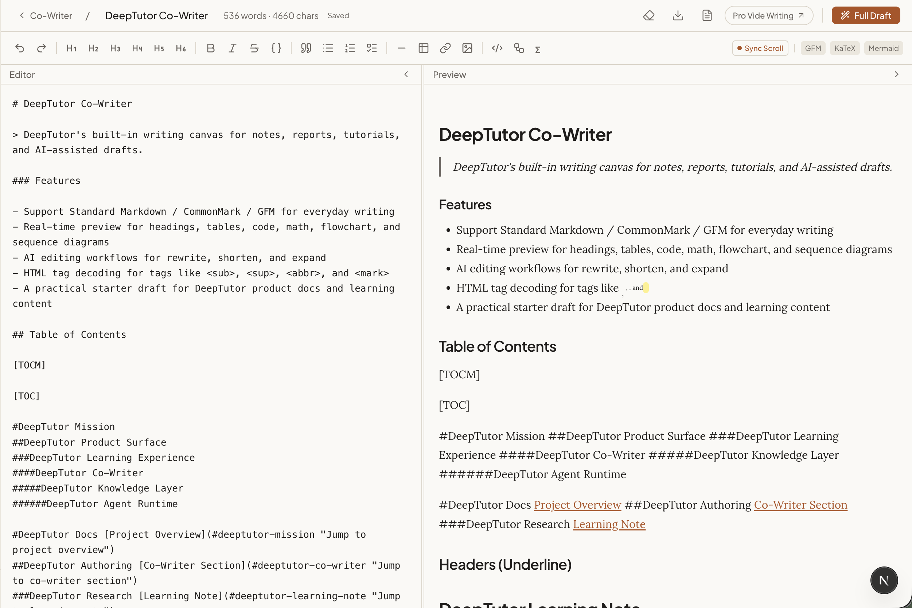
</div>

Co-Writer 将 Chat 的智能直接带到了写作界面。创建和管理多个文档，每个文档都持久化在独立的工作区中——不是一次性的草稿板，而是一个功能完备的多文档 Markdown 编辑器，AI 是一等协作者。

选中任意文本，选择**重写**、**扩展**或**缩短**——可选从你的知识库或网络中汲取上下文。编辑流程非破坏性，支持完整的撤销/重做，你写的每一段内容都可以直接保存到笔记本中，反馈到你的学习生态系统中。

### 📖 Book Engine — 交互式 "活书"

<div align="center">
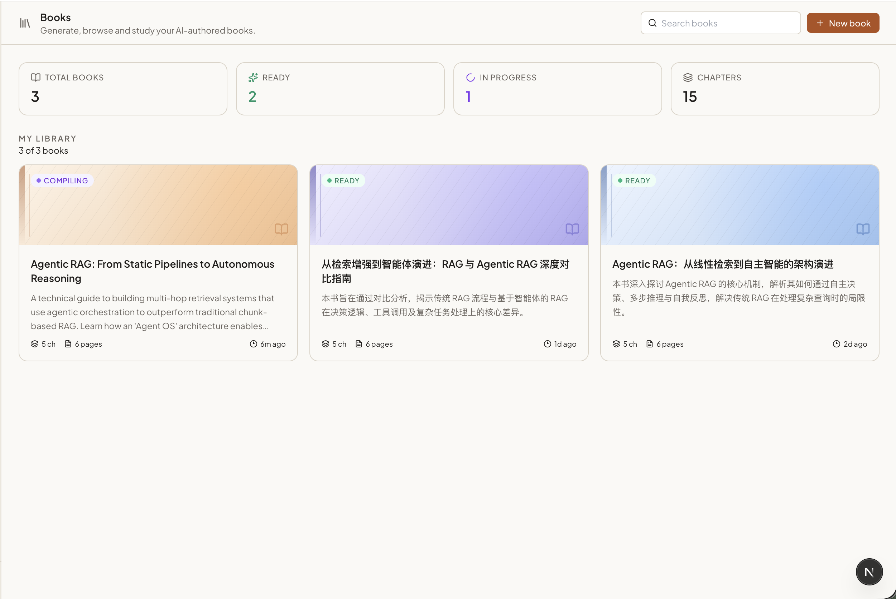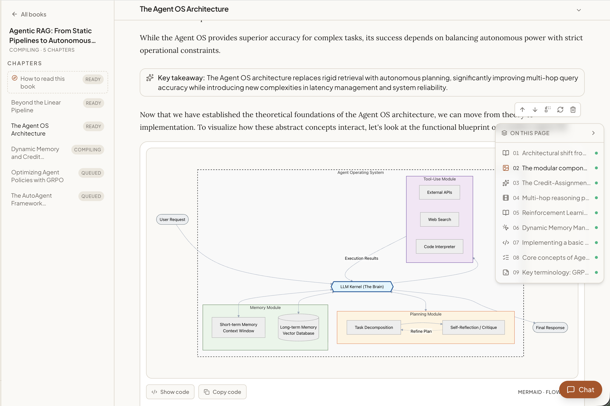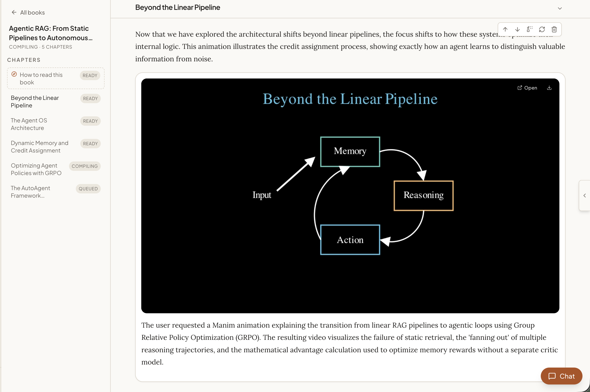
</div>

给 CaiWen 一个主题，指向你的知识库，它就会生成一本结构化、交互式的书籍——不是静态导出，而是一本你可以阅读、自测和讨论的动态文档。

在幕后，一个多 Agent 管道处理繁重工作：提出大纲、从你的知识库中检索相关来源、合成章节树、规划每一页、编译每一个块。你始终掌控——审核方案、重排章节、在任意页面旁边聊天。

页面由 13 种块类型组成——文本、提示框、测验、闪卡、代码、图表、深度探索、动画、交互演示、时间线、概念图、章节和用户笔记——每种都以独立的交互组件渲染。实时进度时间线让你看到编译过程如书籍成形般展开。

### 📚 知识管理 — 你的学习基础设施

<div align="center">
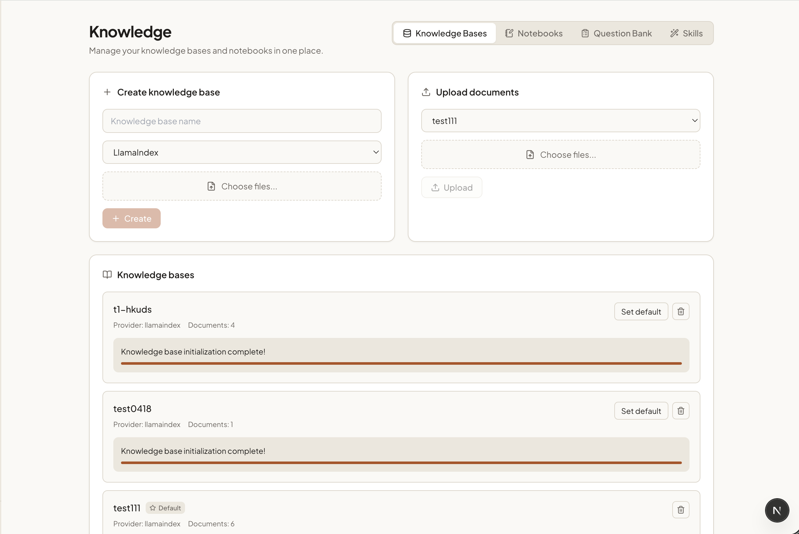
</div>

知识管理是你构建和管理文档集合、笔记和教学角色的地方，为 CaiWen 的一切提供动力。

- **知识库** — 上传 PDF、Office 文件（DOCX/XLSX/PPTX）、Markdown 以及各种文本和代码文件，创建可搜索、RAG 就绪的文档集合。随着你的资料库增长，增量添加文档。
- **笔记本** — 跨会话整理学习记录。将 Chat、Co-Writer、Book 或 Deep Research 中的见解保存到分类、彩色标签的笔记本中。
- **题库** — 浏览和回顾所有生成的测验题目。收藏条目，直接在聊天中 @-提及，以便回顾过往表现。
- **Skills** — 通过 `SKILL.md` 文件创建自定义教学角色。每个 Skill 定义名称、描述、可选触发器和 Markdown 正文，激活后注入到聊天系统提示中——将 CaiWen 变成苏格拉底式导师、同伴学习伙伴、研究助手或你设计的任何角色。

你的知识库不是被动存储——它积极参与每一次对话、每一个研究会话和每一条你创建的学习路径。

### 🧠 记忆 — CaiWen 随你的学习而成长

<div align="center">
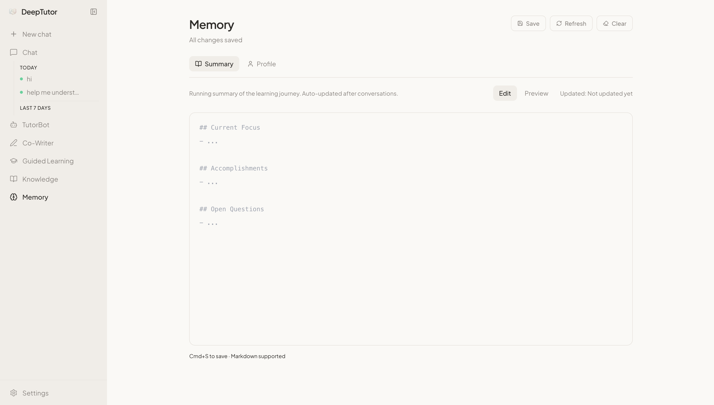
</div>

CaiWen 通过两个互补维度维护对你持久、动态的理解：

- **摘要** — 你学习进度的动态摘要：你学了什么、探索了哪些主题、你的理解如何发展。
- **画像** — 你的学习者身份：偏好、知识水平、目标和沟通风格——通过每次互动自动完善。

记忆在所有功能和所有 TutorBot 之间共享。你使用 CaiWen 越多，它就越个性化和高效。

---

### 🦞 TutorBot — 持久化、自主的 AI 导师

<div align="center">
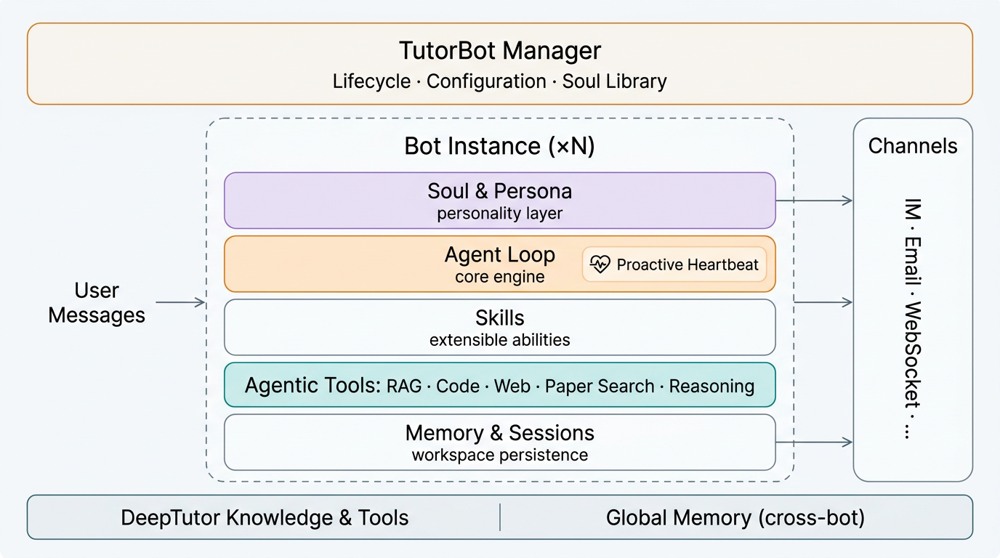
</div>

TutorBot 不是聊天机器人——它是基于 [nanobot](https://github.com/HKUDS/nanobot) 构建的**持久化、多实例 Agent**。每个 TutorBot 运行自己的 Agent 循环，拥有独立的工作区、记忆和个性。创建一位苏格拉底式的数学导师、一位耐心的写作教练和一位严谨的研究顾问——全部同时运行，每一个都与你共同进化。

<div align="center">
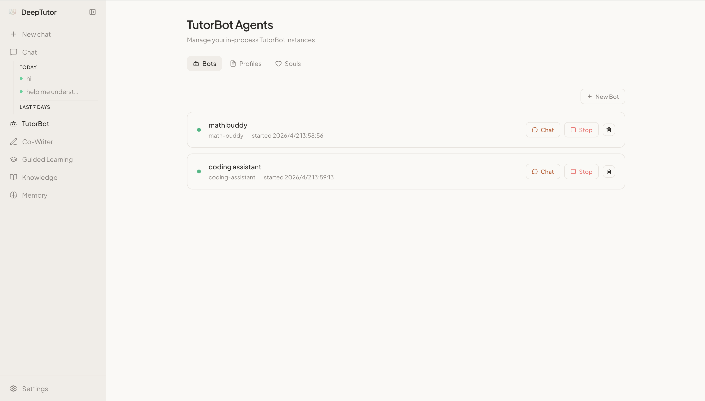
</div>

- **Soul 模板** — 通过可编辑的 Soul 文件定义导师的个性、语气和教学理念。从内置原型（苏格拉底式、鼓励型、严谨型）中选择，或自定义——Soul 塑造每一次回应。
- **独立工作区** — 每个 Bot 有自己的目录，独立的记忆、会话、Skill 和配置——完全隔离，但可以访问 CaiWen 的共享知识层。
- **主动心跳** — Bot 不仅回应——它们主动发起。内置心跳系统支持定期学习签到、复习提醒和计划任务。你的导师即使你不主动去找它，它也会来找你。
- **完整工具访问** — 每个 Bot 都能访问 CaiWen 的完整工具集：RAG 检索、代码执行、网络搜索、学术论文搜索、深度推理和头脑风暴。
- **Skill 学习** — 通过向其工作区添加 Skill 文件来教会你的 Bot 新能力。随着你的需求变化，你导师的能力也随之提升。
- **多渠道存在** — 将 Bot 连接到 Telegram、Discord、Slack、飞书、企业微信、钉钉、Matrix、QQ、WhatsApp、Email 等。你的导师无论你在哪里都能找到你。
- **团队与子 Agent** — 在单个 Bot 内派生子 Agent 或编排多 Agent 团队，完成复杂的长时任务。

```bash
deeptutor bot create math-tutor --persona "使用提问引导的苏格拉底式数学教师"
deeptutor bot create writing-coach --persona "耐心细致的写作指导"
deeptutor bot list                  # 查看你所有活跃的导师
```

---

### ⌨️ CaiWen CLI — Agent 原生接口

<div align="center">
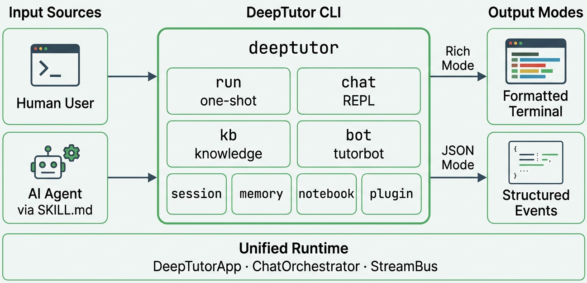
</div>

CaiWen 完全 CLI 原生。每一项能力、知识库、会话、记忆和 TutorBot 都只需一条命令——不需要浏览器。CLI 同时服务人类（丰富的终端渲染）和 AI Agent（结构化 JSON 输出）。

将项目根目录的 [`SKILL.md`](SKILL.md) 交给任何使用工具的 Agent（[nanobot](https://github.com/HKUDS/nanobot) 或任何具有工具访问权限的 LLM），它就能自主配置和操作 CaiWen。

**一次性执行** — 直接从终端运行任何能力：

```bash
deeptutor run chat "解释傅里叶变换" -t rag --kb textbook
deeptutor run deep_solve "证明 √2 是无理数" -t reason
deeptutor run deep_question "线性代数" --config num_questions=5
deeptutor run deep_research "Transformer 中的注意力机制"
deeptutor run visualize "绘制 Transformer 的架构图"
```

**交互式 REPL** — 持久聊天会话，支持实时模式切换：

```bash
deeptutor chat --capability deep_solve --kb my-kb
# REPL 内：使用 /cap、/tool、/kb、/history、/notebook、/config 随时切换
```

**知识库生命周期** — 完全通过终端构建、查询和管理 RAG 就绪的文档集合：

```bash
deeptutor kb create my-kb --doc textbook.pdf       # 从文档创建
deeptutor kb add my-kb --docs-dir ./papers/         # 添加一个论文文件夹
deeptutor kb search my-kb "梯度下降"                 # 直接搜索
deeptutor kb set-default my-kb                       # 设为所有命令的默认知识库
```

**双输出模式** — 人类获得丰富渲染，管道获得结构化 JSON：

```bash
deeptutor run chat "总结第三章" -f rich    # 彩色格式化输出
deeptutor run chat "总结第三章" -f json     # 行分隔 JSON 事件
```

**会话连续性** — 从上次中断的地方继续任何对话：

```bash
deeptutor session list                              # 列出所有会话
deeptutor session open <id>                         # 在 REPL 中恢复会话
```

<details>
<summary><b>CLI 完整命令参考</b></summary>

**顶层命令**

| 命令 | 说明 |
|:---|:---|
| `deeptutor run <capability> <message>` | 单轮执行任意能力（`chat`、`deep_solve`、`deep_question`、`deep_research`、`math_animator`、`visualize`） |
| `deeptutor chat` | 交互式 REPL，可选 `--capability`、`--tool`、`--kb`、`--language` |
| `deeptutor serve` | 启动 CaiWen API 服务器 |

**`deeptutor bot`**

| 命令 | 说明 |
|:---|:---|
| `deeptutor bot list` | 列出所有 TutorBot 实例 |
| `deeptutor bot create <id>` | 创建并启动新 Bot（`--name`、`--persona`、`--model`） |
| `deeptutor bot start <id>` | 启动 Bot |
| `deeptutor bot stop <id>` | 停止 Bot |

**`deeptutor kb`**

| 命令 | 说明 |
|:---|:---|
| `deeptutor kb list` | 列出所有知识库 |
| `deeptutor kb info <name>` | 查看知识库详情 |
| `deeptutor kb create <name>` | 从文档创建（`--doc`、`--docs-dir`） |
| `deeptutor kb add <name>` | 增量添加文档 |
| `deeptutor kb search <name> <query>` | 搜索知识库 |
| `deeptutor kb set-default <name>` | 设为默认知识库 |
| `deeptutor kb delete <name>` | 删除知识库（`--force`） |

**`deeptutor memory`**

| 命令 | 说明 |
|:---|:---|
| `deeptutor memory show [file]` | 查看记忆（`summary`、`profile` 或 `all`） |
| `deeptutor memory clear [file]` | 清除记忆（`--force`） |

**`deeptutor session`**

| 命令 | 说明 |
|:---|:---|
| `deeptutor session list` | 列出会话（`--limit`） |
| `deeptutor session show <id>` | 查看会话消息 |
| `deeptutor session open <id>` | 在 REPL 中恢复会话 |
| `deeptutor session rename <id>` | 重命名会话（`--title`） |
| `deeptutor session delete <id>` | 删除会话 |

**`deeptutor notebook`**

| 命令 | 说明 |
|:---|:---|
| `deeptutor notebook list` | 列出笔记本 |
| `deeptutor notebook create <name>` | 创建笔记本（`--description`） |
| `deeptutor notebook show <id>` | 查看笔记本记录 |
| `deeptutor notebook add-md <id> <path>` | 导入 Markdown 作为记录 |
| `deeptutor notebook replace-md <id> <rec> <path>` | 替换 Markdown 记录 |
| `deeptutor notebook remove-record <id> <rec>` | 移除记录 |

**`deeptutor book`**

| 命令 | 说明 |
|:---|:---|
| `deeptutor book list` | 列出工作区中所有书籍 |
| `deeptutor book health <book_id>` | 检查知识库漂移和书籍健康状态 |
| `deeptutor book refresh-fingerprints <book_id>` | 刷新知识库指纹并清除过期页面 |

**`deeptutor config` / `plugin` / `provider`**

| 命令 | 说明 |
|:---|:---|
| `deeptutor config show` | 打印当前配置摘要 |
| `deeptutor plugin list` | 列出已注册的工具和能力 |
| `deeptutor plugin info <name>` | 查看工具或能力详情 |
| `deeptutor provider login <provider>` | 提供商认证（`openai-codex` OAuth 登录；`github-copilot` 验证现有 Copilot 认证会话） |

</details>

---

### 👥 多用户 — 共享部署与用户隔离工作区

<div align="center">
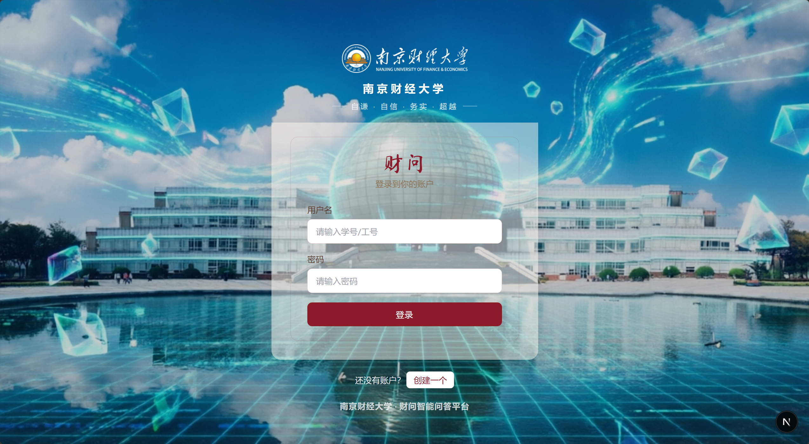
</div>

打开认证开关，CaiWen 就变成一个多租户部署，具有**用户隔离工作区**和**管理员管理资源**。第一个注册的人成为管理员，为所有其他人配置模型、API 密钥和知识库。后续账户由管理员创建（仅限邀请），每个人拥有自己独立的聊天历史 / 记忆 / 笔记本 / 知识库，且只能看到管理员分配给他们的大模型、知识库和 Skill。

**快速开始（5 步）：**

```bash
# 1. 在项目根目录 .env 中启用认证。
echo 'AUTH_ENABLED=true' >> .env
# 可选 — JWT 签名密钥。留空则在首次启动时自动生成。
echo 'AUTH_SECRET=<粘贴 64 位以上随机字符>' >> .env

# 2. 重启 Web 服务 — start_web.py 会将 AUTH_ENABLED 同步到前端。
python scripts/start_web.py

# 3. 打开 http://localhost:3782/register 创建第一个账户。
#    首次注册是唯一一次公开注册；该用户成为管理员，
#    /register 端点随后自动关闭。

# 4. 作为管理员，前往 /admin/users → "添加用户" 为团队成员创建账户。

# 5. 为每个用户，点击滑块图标 → 分配 LLM 配置、知识库和 Skill。
#    保存。用户现在可以登录并开始使用。
```

**管理员可见：**

- **完整设置页面**（`/settings`）——管理 LLM / Embedding / 搜索提供商、API 密钥、模型目录和运行时"应用"。
- **用户管理**（`/admin/users`）——创建、升权、降权、删除账户。公有 `/register` 端点会在首个管理员存在后自动关闭；后续账户通过 `POST /api/v1/auth/users` 创建（仅管理员可用）。
- **授权编辑器** — 为每个非管理员用户选择可用的模型配置、知识库和 Skill。授权仅包含**逻辑 ID**；API 密钥绝不会跨越授权边界。
- **审计追踪** — 每次授权变更和资源访问都会追加到 `multi-user/_system/audit/usage.jsonl`。

**普通用户获得：**

- **隔离工作区**（`multi-user/<uid>/`）——自己的聊天历史（`chat_history.db`）、记忆（`SUMMARY.md` / `PROFILE.md`）、笔记本和个人知识库。默认情况下没有任何共享内容。
- **管理员分配的知识库和 Skill 的只读访问**，在自己的资源旁边以"管理员分配"标记内联显示。
- **精简设置页面** — 仅显示主题、语言和授权模型摘要。API 密钥、Base URL 和提供商端点永远不会返回给非管理员请求。
- **受限 LLM** — 聊天轮次通过管理员分配的模型路由。如果没有授权任何 LLM，请求会被直接拒绝（不会静默回退到管理员的密钥）。

**工作区布局：**

```
multi-user/
├── _system/
│   ├── auth/users.json          # 哈希凭据、角色
│   ├── auth/auth_secret         # JWT 签名密钥（自动生成）
│   ├── grants/<uid>.json        # 每用户资源授权（管理员管理）
│   └── audit/usage.jsonl        # 审计追踪
└── <uid>/
    ├── user/
    │   ├── chat_history.db
    │   ├── settings/interface.json
    │   └── workspace/{chat,co-writer,book,...}
    ├── memory/{SUMMARY.md,PROFILE.md}
    └── knowledge_bases/...
```

**配置参考：**

| 变量 | 是否必填 | 说明 |
|:---|:---|:---|
| `AUTH_ENABLED` | 是 | 设为 `true` 启用多用户认证。默认 `false`（单用户模式——所有路径均为管理员权限）。 |
| `AUTH_SECRET` | 推荐 | JWT 签名密钥。留空时在 `multi-user/_system/auth/auth_secret` 下自动生成。 |
| `AUTH_TOKEN_EXPIRE_HOURS` | 否 | JWT 有效期；默认 `24` 小时。 |
| `AUTH_USERNAME` / `AUTH_PASSWORD_HASH` | 否 | 单用户后备凭据（旧版环境变量路径）。使用多用户时请留空。 |
| `NEXT_PUBLIC_AUTH_ENABLED` | 自动 | 由 `start_web.py` 从 `AUTH_ENABLED` 同步，使 Next.js 中间件将未认证请求重定向到 `/login`。 |

> ⚠️ **PocketBase 模式（设置 `POCKETBASE_URL`）仅支持单用户。** PocketBase 默认 schema 在 `users` 上没有 `role` 字段（每次登录解析为 `role=user`，无法创建管理员），且 `sessions` / `messages` / `turns` 查询未按 `user_id` 过滤。多用户部署请保持 `POCKETBASE_URL` 为空，使用默认的 JSON/SQLite 后端。

> ⚠️ **单进程建议。** 首个用户成为管理员的提升由进程内 `threading.Lock` 保护。多 Worker 部署应先离线创建管理员（以 `AUTH_ENABLED=false` 启动，通过 `python scripts/start_tour.py` 或引导流程注册管理员，然后打开该标志），或使用外部系统支持用户存储。

## 🗺️ 路线图

| 状态 | 里程碑 |
|:---:|:---|
| 🎯 | **认证与登录** — 公开部署的可选登录页面，支持多用户 |
| 🎯 | **主题与外观** — 多样化主题选项和可定制 UI 外观 |
| 🎯 | **交互优化** — 优化图标设计和交互细节 |
| 🔜 | **更好的记忆管理** — 集成更好的记忆管理系统 |
| 🔜 | **LightRAG 集成** — 集成 [LightRAG](https://github.com/HKUDS/LightRAG) 作为高级知识库引擎 |
| 🔜 | **文档站点** — 包含指南、API 参考和教程的综合文档页面 |

> 如果 CaiWen 对你有用，[给我们一颗 star](https://github.com/112-Li-del/CaiWen/stargazers)——这是对我们最大的支持！

---

## 🤝 贡献

欢迎提交 Issue 和 Pull Request！

---

基于 [Apache License 2.0](LICENSE) 许可。

